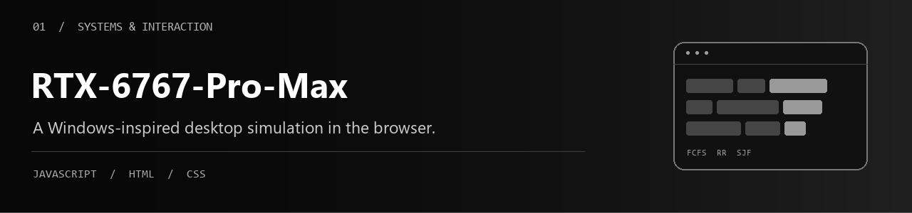
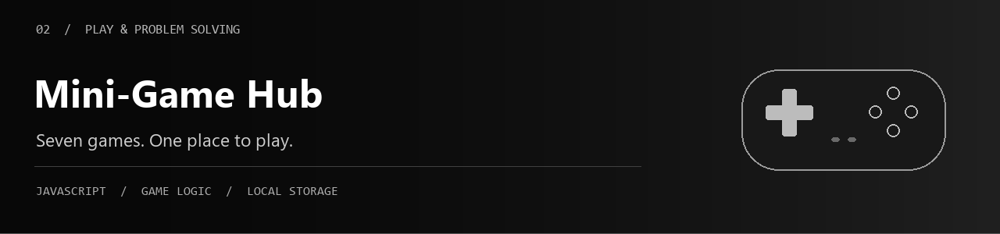
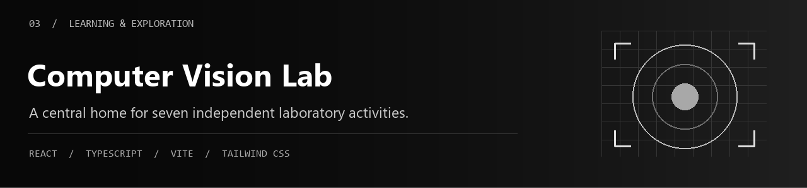

<picture>
  <source media="(prefers-reduced-motion: reduce)" srcset="./assets/profile-header.png">
  
</picture>

  <a href="#selected-projects">Selected projects</a> &nbsp;·&nbsp;
  <a href="#technical-toolkit">Technical toolkit</a> &nbsp;·&nbsp;
  <a href="https://v-exor.github.io/CSST106_Lab_Compilation/">Vision lab portfolio</a> &nbsp;·&nbsp;
  <a href="mailto:keannerock@gmail.com">Contact</a>

I'm **Keanne Jericho M. Rosario**, a **BS Computer Science student at Laguna State Polytechnic University**, based in the Philippines. I build interactive web projects that turn ideas from class into experiences people can explore, use, and play.

My work spans browser-based simulations, JavaScript games, and a computer vision laboratory portfolio. I enjoy working through application logic and organizing it into clear, usable interfaces.

## Selected projects

| Project | Focus | Explore |
| :--- | :--- | :--- |
| [RTX-6767-Pro-Max](https://github.com/v-Exor/RTX-6767-Pro-Max) | Desktop UI and operating system concepts | [Live simulator ↗](https://v-exor.github.io/RTX-6767-Pro-Max/) |
| [GAME_NEWEST](https://github.com/v-Exor/GAME_NEWEST) | Seven browser games and game logic | [Play the games ↗](https://v-exor.github.io/GAME_NEWEST/) |
| [CSST106_Lab_Compilation](https://github.com/v-Exor/CSST106_Lab_Compilation) | Computer vision laboratory portfolio | [Visit the portfolio ↗](https://v-exor.github.io/CSST106_Lab_Compilation/) |

### 01 · RTX-6767-Pro-Max

A **Windows-inspired operating system simulator** built with vanilla JavaScript, HTML, and CSS. The browser acts as a desktop for exploring operating system concepts.

- **Desktop interactions:** draggable, resizable windows with minimize, maximize, taskbar, and app switching.
- **OS concepts:** FCFS, Round Robin, and SJF scheduling with Gantt charts; process management, memory allocation, and a printer spooler.
- **Built-in tools:** a virtual file explorer, terminal, calculator, paint app, and settings.

**Demonstrates:** state management, scheduling algorithms, modular JavaScript, and interactive UI development.

[**Explore the simulator ↗**](https://v-exor.github.io/RTX-6767-Pro-Max/) &nbsp;·&nbsp; [View source](https://github.com/v-Exor/RTX-6767-Pro-Max)

### 02 · GAME_NEWEST / Mini-Game Hub

A **seven-game browser arcade** with a shared hub: Tic Tac Toe, Memory Match, Connect Four, Jumping Capybara, Snake, Checkers, and Rock, Paper, Scissors.

- **Game logic:** turn handling, legal moves, win conditions, collision detection, and score tracking across different game types.
- **Ways to play:** local two-player and computer-opponent modes in selected board games, plus difficulty options in selected games.
- **Saved progress:** browser local storage keeps best scores for Snake and Jumping Capybara, and best times for Memory Match.

**Demonstrates:** event-driven programming, game state, computer-opponent logic, and browser persistence.

[**Play the games ↗**](https://v-exor.github.io/GAME_NEWEST/) &nbsp;·&nbsp; [View source](https://github.com/v-Exor/GAME_NEWEST)

### 03 · CSST106_Lab_Compilation / Computer Vision Lab

A **React and TypeScript compilation website for CSST106 — Computer Vision**, connecting seven independently hosted laboratory activities through one organized portfolio.

- **Discover and navigate:** searchable activities, topic filters, grid/list views, and individual laboratory pages with overview, workspace, and resources tabs.
- **Study areas:** image fundamentals, edge detection, histograms, SURF, PCA, and YOLOv8, with links to the independent laboratory websites.
- **Delivery and usability:** responsive layouts, keyboard-accessible navigation, reduced-motion support, and a GitHub Actions deployment workflow.

**Demonstrates:** component-based development, typed configuration, accessible navigation, and static-site deployment. This repository is the compilation portal; the laboratory applications are hosted separately.

[**Visit the vision lab ↗**](https://v-exor.github.io/CSST106_Lab_Compilation/) &nbsp;·&nbsp; [View source](https://github.com/v-Exor/CSST106_Lab_Compilation)

## Technical toolkit

| Area | Technologies and practices used in these projects |
| :--- | :--- |
| Frontend | JavaScript, TypeScript, HTML, CSS, React |
| Styling and tooling | Tailwind CSS, Vite, npm |
| Application logic | DOM events, game loops, browser local storage, shared application state |
| Delivery | Git, GitHub, GitHub Pages, GitHub Actions |
| Areas of study | Operating systems, game development, computer vision |

## Background & contact

**Education:** BS Computer Science · Laguna State Polytechnic University 
**Location:** Philippines 
**Email:** [keannerock@gmail.com](mailto:keannerock@gmail.com)

Alongside my development projects, I have experience with data entry, research, and organizing information using Microsoft Excel and Access. I bring attention to detail and a willingness to learn to the work I take on.

Explore a project, try a demo, or get in touch.

