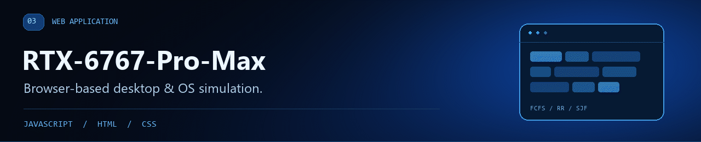
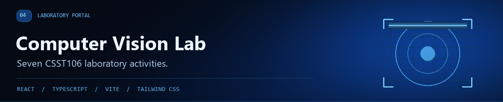
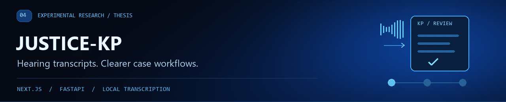
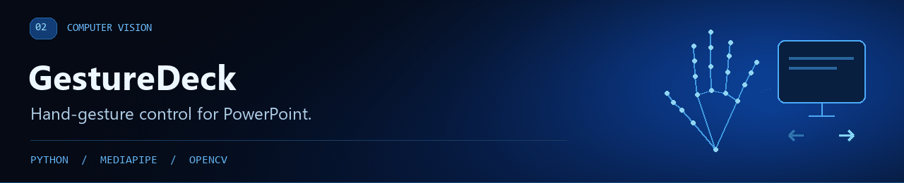

<picture>
  <source media="(prefers-reduced-motion: reduce)" srcset="./assets/profile-header.png">
  
</picture>

  <a href="#highlighted-projects">🚀 Highlighted Projects</a> &nbsp;·&nbsp;
  <a href="#my-toolbox">⚡ My toolbox</a> &nbsp;·&nbsp;
  <a href="mailto:keannerock@gmail.com">💬 Say hello</a>

### Hey, I'm Keanne 👋

A Computer Science student at **Laguna State Polytechnic University**, based in the Philippines. I like turning things I learn into things you can click, explore, and play.

Sometimes that means building a whole desktop in a browser. Sometimes it's a game that turns into *one more round*. Lately, it's been exploring the world of computer vision. 🌌

## Highlighted Projects

🖥️ [Explore a desktop](https://v-exor.github.io/RTX-6767-Pro-Max/) &nbsp;·&nbsp; 🎮 [Play a game](https://v-exor.github.io/GAME_NEWEST/) &nbsp;·&nbsp; 👁️ [Step into the vision lab](https://v-exor.github.io/CSST106_Lab_Compilation/)

⚖️ [Explore my thesis project](#justice-kp) &nbsp;·&nbsp; ✋ [Meet GestureDeck](#gesturedeck)

### 🖥️ RTX-6767-Pro-Max

<a href="https://v-exor.github.io/RTX-6767-Pro-Max/">
  <picture>
    <source media="(prefers-reduced-motion: reduce)" srcset="./assets/project-os.png">
    
  </picture>
</a>

**A desktop playground, right in your browser.** Open apps, drag windows around, try the terminal, or see what happens behind the scenes in an operating system.

- 🪟 A Windows-inspired desktop with resizable windows, a taskbar, and built-in apps.
- ⚙️ CPU scheduling with FCFS, Round Robin, and SJF, plus process and memory tools.
- 🛠️ A virtual file explorer, paint app, calculator, terminal, and printer spooler.

`JavaScript` `HTML` `CSS`

[**Launch the desktop ↗**](https://v-exor.github.io/RTX-6767-Pro-Max/) &nbsp;·&nbsp; [Peek at the code](https://github.com/v-Exor/RTX-6767-Pro-Max)

### 🎮 GAME_NEWEST · Mini-Game Hub

<a href="https://v-exor.github.io/GAME_NEWEST/">
  <picture>
    <source media="(prefers-reduced-motion: reduce)" srcset="./assets/project-games.png">
    
  </picture>
</a>

**Pick a game. Take a break. Try to beat your best.** Seven mini-games share one home: Tic Tac Toe, Memory Match, Connect Four, Jumping Capybara, Snake, Checkers, and Rock, Paper, Scissors.

- 🤖 Challenge a computer opponent or a friend in selected board games.
- 🧠 Mix things up with difficulty options in selected games.
- 🏆 Keep your best Snake and Capybara scores, and Memory Match times, in your browser.

`JavaScript` `HTML` `CSS` `localStorage`

[**Let's play ↗**](https://v-exor.github.io/GAME_NEWEST/) &nbsp;·&nbsp; [Peek at the code](https://github.com/v-Exor/GAME_NEWEST)

### 👁️ CSST106_Lab_Compilation · Computer Vision Lab

<a href="https://v-exor.github.io/CSST106_Lab_Compilation/">
  <picture>
    <source media="(prefers-reduced-motion: reduce)" srcset="./assets/project-vision.png">
    
  </picture>
</a>

**A place to explore how computers see.** My CSST106 compilation brings seven independently hosted laboratory activities together in one React and TypeScript website.

- 🔎 Search activities, filter by topic, and switch between grid and list views.
- 🧪 Explore lab links covering images, edges, histograms, SURF, PCA, and YOLOv8.
- 🧭 Jump into each lab's overview, workspace, and resources from a responsive interface.

`React` `TypeScript` `Vite` `Tailwind CSS`

[**Explore the vision lab ↗**](https://v-exor.github.io/CSST106_Lab_Compilation/) &nbsp;·&nbsp; [Peek at the code](https://github.com/v-Exor/CSST106_Lab_Compilation)

The compilation is the central portal; the laboratory applications live on their own sites.

### ⚖️ JUSTICE-KP · Experimental Research / Thesis

<a href="https://v-exor.github.io/Justice_KP_Pages/">
  <picture>
    <source media="(prefers-reduced-motion: reduce)" srcset="./assets/project-justice.png">
    
  </picture>
</a>

**From hearing transcripts to a clearer case workflow.** Developed during our experimental research / thesis, JUSTICE-KP is a transcription-assisted, rule-based decision-support prototype for **Katarungang Pambarangay**.

- 🎙️ Record hearings, transcribe speech locally, identify speakers, and review editable transcripts.
- 🧭 Support case analysis, jurisdiction checks, and sensitive-case referral routing with explainable rule traces.
- 📋 Bring hearing schedules, evidence, KP form workflows, and thesis validation tools into one system.

`Next.js` `TypeScript` `Tailwind CSS` `Python` `FastAPI` `faster-whisper`

[**Explore the research showcase ↗**](https://v-exor.github.io/Justice_KP_Pages/) &nbsp;·&nbsp; [System source](https://github.com/v-Exor/JUSTICE-KP-System) &nbsp;·&nbsp; [Showcase source](https://github.com/v-Exor/Justice_KP_Pages)

The showcase presents the research; it is separate from the system application. Final decisions remain with barangay officials.

### ✋ GestureDeck · Hand-Gesture Slide Control

<a href="https://github.com/v-Exor/GestureDeck_CV_Project">
  <picture>
    <source media="(prefers-reduced-motion: reduce)" srcset="./assets/project-gesture.png">
    
  </picture>
</a>

**Turn your hand. Move your slides.** GestureDeck is a **CSST 106 Computer Vision** classroom prototype that uses a webcam, MediaPipe, and local geometric and temporal rules to control a Windows PowerPoint slideshow.

- ✋ Turn an open right hand from palm to back for the next slide, or back to palm for the previous slide.
- ✊ Hold a fist to pause or resume control; hold a Victory pose to exit the slideshow.
- 🔎 See detected hand joints and recognition feedback, with optional local recording for review.

`Python` `MediaPipe` `OpenCV` `Computer Vision` `Windows PowerPoint`

[**Explore GestureDeck ↗**](https://github.com/v-Exor/GestureDeck_CV_Project) &nbsp;·&nbsp; [Setup & gesture guide](https://github.com/v-Exor/GestureDeck_CV_Project#gesture-controls)

A local Windows demonstration prototype. Fast turns can miss commands; the inspected trials do not establish general recognition accuracy.

## My toolbox

⚡ **For building:** JavaScript · TypeScript · HTML · CSS · React 
🎨 **For the interface:** Tailwind CSS · Vite 
🚀 **For sharing it:** Git · GitHub · GitHub Pages · GitHub Actions

### Let's connect 💬

Got an idea, a question, or just want to say hi? [Drop me an email](mailto:keannerock@gmail.com) or [explore my repositories](https://github.com/v-Exor?tab=repositories).

Thanks for stopping by. Stay curious, and have fun exploring. ✨

